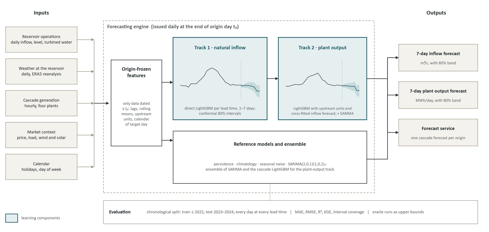

# TEF-RES Service 6: Cascaded Hydropower Forecasting — Implementation

Service of the EnerTEF project (TEF-RES), for the Aliakmonas hydropower cascade in Northern Greece.

Specification: [README.md](README.md)

## What it does

Integrated short-term forecasting for the Aliakmonas cascade (Ilarionas → Polyfyto → Sfikia → Asomata):
**natural inflow at Ilarionas reservoir** and **power production at Asomata HPP**, 1–7 days ahead, with the inflow
forecast feeding the production forecast. Both come with an 80% interval.



## Protocol

- A forecast is issued at the end of origin day *t₀* for *t₀+1 … t₀+7*. Every feature reads only data dated ≤ *t₀*;
  the calendar of the target day is the only thing known about the future. One LightGBM per lead time (direct
  strategy).
- Origins every day; each test day is scored at all seven lead times.
- **Split A** (cascade): train ≤ 2022, test 2023-01-01 → 2024-12-31.
- **Split B** (public data only, no reservoir inflow): train ≤ 2024, test 2025-01-01 → 2026-09-04.
- **Cascade link:** the production model receives the Track 1 inflow forecast for each target day. In training these
  are *cross-fitted* (each year forecast by a model trained on the other years), so the production model learns from
  forecasts with realistic error, not in-sample fits.
- **80% intervals:** LightGBM quantile models, conformalised on the last training year (raw quantiles covered only
  ~55–65%).
- **Oracle** rows use the observed future (weather, or inflow) as if it were a perfect forecast. They are upper
  bounds, not achievable forecasts.

Assumption: the inflow and generation for day *t₀* are available when the *t₀+1* forecast is issued.

## Results

### Track 1 — Ilarionas natural inflow (m³/s), test 2023–24, lead times 1–7 pooled

| Model | MAE | RMSE | R² (NSE) | KGE | 80% cover | MAE skill vs persistence |
|---|---|---|---|---|---|---|
| Persistence | 13.3 | 29.7 | 0.09 | 0.55 | — | — |
| Climatology | 17.1 | 29.5 | 0.11 | 0.30 | — | −28% |
| **LightGBM** | **11.2** | **24.9** | **0.36** | 0.48 | 0.74 | **+16%** |
| LightGBM + weather (oracle) | 8.5 | 20.1 | 0.59 | 0.67 | 0.76 | +36% |

The gap between the two LightGBM rows (−24% MAE) is what a perfect 7-day weather forecast is worth; a real weather
forecast will land between them. At 1 day ahead the error is small (MAE 5.6); by day 7 the model without weather
(14.5) sits nearer persistence (16.8) than the oracle (10.4), because rain events cannot be predicted from the past
alone.

### Track 2 — Asomata production (MWh/day), split A, test 2023–24

| Model | MAE | RMSE | R² | MAE skill vs seasonal naive |
|---|---|---|---|---|
| Persistence | 117.9 | 181.8 | 0.46 | 0% |
| Seasonal naive (same weekday last week) | 118.4 | 182.1 | 0.46 | — |
| SARIMA(2,0,1)(1,0,1)₇ | 106.0 | 151.1 | 0.62 | +10% |
| LightGBM — Asomata only | 102.5 | 150.3 | 0.63 | +13% |
| LightGBM + upstream units | 101.4 | 148.2 | 0.64 | +14% |
| **LightGBM cascade: + inflow forecast** | **100.5** | 149.1 | 0.63 | **+15%** |
| LightGBM cascade: + actual inflow (oracle) | 99.0 | 147.5 | 0.64 | +16% |
| **Ensemble (SARIMA + LightGBM cascade)** | **99.3** | **145.4** | **0.65** | **+16%** |

### Track 2 — public data only, split B, test 2025 → 2026-09

| Model | MAE | R² | bias |
|---|---|---|---|
| **Persistence** | **118.4** | **0.76** | −2 |
| SARIMA | 126.1 | 0.76 | −16 |
| Ensemble (SARIMA + LightGBM upstream) | 126.4 | 0.74 | −19 |
| LightGBM + upstream units | 142.6 | 0.66 | −21 |
| LightGBM — Asomata only | 144.1 | 0.59 | −52 |
| Seasonal naive | 141.8 | 0.66 | −5 |

### What the results say

1. **The cascade information helps, but only a little.** Upstream units, then the inflow forecast, take MAE from
   102.5 to 100.5 MWh/day; even *perfect* inflow knowledge reaches only 99.0. At daily resolution Asomata is
   dispatched against the market, not paced by the water arriving. The upstream *generation* (Polyfyto 7-day mean is
   the single strongest feature) carries more than the inflow does, because it reflects the same dispatch decisions.
2. **Inflow is forecastable a few days out; weather is the lever.** The model beats persistence by 16%; perfect
   weather would make it 36%. Connecting a real weather forecast is the highest-value next step.
3. **2026 breaks the tree models.** Asomata produced on average 749 MWh/day in 2026, twice any training year
   (2017–2025: 258–465). LightGBM cannot extrapolate beyond levels it has seen and under-forecasts from January to
   April 2026; persistence and SARIMA follow the level. In 2025, a normal year, the ensemble is best (MAE 77 vs 82
   for persistence). A production service needs a regime guard, e.g. fall back to SARIMA/persistence when recent
   production exceeds the training range.
4. **Intervals:** inflow bands are close to nominal (74–76% for 80%). Production bands over-cover (90%) and are wide
   (~440 MWh), because the calibration year 2022 was the energy-crisis year. Calibrating on a rolling recent window
   would tighten them.

## Data

The input data are not part of this repository. The reservoir operations data are PPC's and are not public; the rest
come from public sources. The code expects four files in `data/`:

| File | Source | Content | Columns used |
|---|---|---|---|
| `ilarionas.csv` | PPC (not public) | daily reservoir operations at Ilarionas, 2015 → 2024 | `date`, `avg_natural_inflow_m3s`, `reservoir_water_level_m`, `hpp_production_water_1000m3` |
| `weather_ilarionas.csv` | Open-Meteo, ERA5 reanalysis | observed daily weather at the reservoir | `date`, `total_precipitation`, `rainfall`, `snowfall`, `temperature_2m`, `temperature_min`, `temperature_max`, `snow_depth`, `solar_radiation`, `degree_days`, `api`, `snow_water_equivalent` |
| `entsoe_cascade.parquet` | ENTSO-E Transparency Platform | hourly actual generation (MW) of Ilarionas, Polyfyto, Sfikia, Asomata; tz-aware index, columns keyed by unit name at the first level | unit columns |
| `entsoe_market.parquet` | ENTSO-E Transparency Platform | hourly day-ahead price, day-ahead load forecast, wind and solar forecast for Greece; tz-aware index | `price_da`, `load_forecast_da`, `ws_solar`, `ws_wind_onshore` |

Asomata production is the ENTSO-E series summed to daily MWh. It is public and live, and matches PPC's own record
at r = 0.999. Without `ilarionas.csv`, the service runs in the public-data-only configuration (split B).

## Running

```bash
pip install -r requirements.txt

python run.py                          # full backtest and figures
python -m cascade.plots                # re-draw figures only
python forecast.py                     # one 7-day cascade forecast from the latest origin
python forecast.py --origin 2024-06-15
```

Outputs are written to `output/`: `results/` (metrics overall and per lead time, every forecast in long format
`date | y_true | y_pred | origin | step | q10 | q90 | model`, cross-fitted inflow forecasts, feature importance),
`figures/` and `forecasts/`. Progress of a running backtest: `output/progress.txt` (status and ETA) and
`output/progress.log`.

## Code

| File | Role |
|---|---|
| `cascade/data.py` | load and align the four sources on a daily calendar |
| `cascade/features.py` | origin-frozen features, Greek holidays, oracle weather |
| `cascade/models.py` | direct LightGBM, conformal intervals, baselines, SARIMA, metrics |
| `cascade/plots.py` | figures |
| `cascade/progress.py` | progress file and ETA |
| `run.py` | the backtest |
| `forecast.py` | the service: one forecast from one origin |

## Not done yet

- Real weather forecasts in place of the oracle (Open-Meteo Forecast API live; Historical Forecast / Previous Runs
  API for an honest backtest).
- A live reservoir inflow feed; without it the inflow track stops at 2024-12-31.
- Regime guard for out-of-range years like 2026.
- Hourly day-ahead production.
- Hyper-parameters are fixed, not tuned; one seed.

## Funding

This project has received funding from the European Union's Horizon Europe Research and Innovation programme under
Grant Agreement No 101172887.
